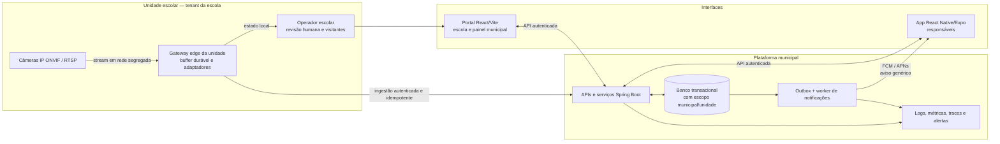

# Plano final de produção — Plataforma Municipal de Operação Escolar, Acesso e Frequência

**Status deste documento:** arquitetura-alvo proposta para descoberta, contratação, desenvolvimento e piloto. Não é aprovação jurídica, autorização para tratar biometria, especificação contratual final nem garantia de desempenho. Os valores de SLO e desempenho adiante são metas iniciais para validação e aceite.

## 1. Objetivo e escopo preservado

A solução proposta integra a operação das unidades escolares a um painel municipal, com portal web, aplicativo de responsáveis, câmeras IP e gateway edge por unidade. O escopo funcional das especificações permanece: cadastro de alunos, responsáveis, professores e funcionários; reconhecimento facial e gestão biométrica como capacidade **condicional, desabilitada por padrão**; controle de acesso; frequência, presença, ausências e atrasos; monitoramento de eventos e alertas; relatórios por aluno, turma e período com exportação PDF e Excel; visitantes e autorizações temporárias; notificações a responsáveis; e auditoria de registros e ocorrências. Também permanecem os fluxos de entrada e saída, acompanhamento de mais de um estudante, cadastro de responsáveis autorizados, histórico diário, consulta de frequência, comunicação de ocorrências e avisos da escola e gestão centralizada municipal.

O fluxo desejado de identificação simultânea de várias pessoas em movimento é requisito a validar, não desempenho presumido. Nenhuma correspondência automática deve, por si só, confirmar presença, negar acesso ou gerar consequência escolar. Devem existir verificação humana e uma alternativa não biométrica equivalente, acessível e sem prejuízo.

## 2. Princípios e decisões de arquitetura

- **Tecnologia preferida:** aplicação web React com Vite; backend Spring Boot. Recomenda-se planejar um aplicativo multiplataforma em React Native/Expo para Android e iOS; esta é uma recomendação de arquitetura, não entrega de código neste plano.
- **Separação por camadas:** câmeras IP e gateway edge isolados na unidade; serviços centrais de APIs, regras de negócio e persistência; interfaces web e mobile sem acesso direto às câmeras, ao banco ou a templates biométricos.
- **Implantação multiunidade:** município/Secretaria é o escopo superior; cada escola/unidade é um tenant operacional subordinado. O acesso e os dados são sempre delimitados no servidor por vínculos autorizados.
- **Minimização:** fluxo normal envia eventos e metadados mínimos. Vídeo e imagens não são enviados nem persistidos centralmente por padrão. Imagem de pessoa não cadastrada não deve ser persistida por padrão.
- **Biometria real bloqueada:** nenhum dado biométrico real será coletado ou processado até haver análise jurídica e do encarregado/DPO, finalidade e necessidade/proporcionalidade demonstradas, avaliação do melhor interesse, RIPD, salvaguardas e aprovação formal do controlador. Este plano não escolhe nem declara base legal.
- **Eventos como registro canônico:** entradas, saídas, correções, revisão humana, visitantes e alertas são registrados como eventos auditáveis; frequência e painéis são projeções derivadas que podem ser recalculadas sem apagar o histórico original.
- **Protótipo não é produção:** o `plan.md` descreve aplicação de protótipo com fluxo de câmera no navegador, cofre cifrado no cliente, autenticação simplificada e banco MySQL compartilhado de Preview/produção. Essa configuração não é arquitetura de produção aprovada; não se deve promover o banco compartilhado, o modelo de cofre, o mecanismo de consentimento ou a implantação monolítica do protótipo como solução municipal. O início de produção requer desenho, ambientes, identidade, autorização, segregação, operação, segurança e migração próprios.

## 3. Arquitetura-alvo e fluxo

**Unidade escolar:** câmeras IP ficam em rede segregada, com fluxo de mídia acessível ao gateway local somente pelas regras de rede necessárias. O gateway recebe stream e eventos disponíveis no equipamento, verifica estado/qualidade, mantém fila transacional durável e envia eventos mínimos ao backend quando houver conectividade. O gateway não é autoridade acadêmica nem fonte de permissões; a unidade mantém procedimento manual seguro para indisponibilidade.

**Câmeras e integração:** novas aquisições devem avaliar compatibilidade funcional com ONVIF Profile T para streaming e, quando metadados/analytics forem necessários, Profile M; validar cada implementação e capacidade em teste de aceitação. Esses perfis não atestam reconhecimento facial nem desempenho. RTSP é transporte/controle de mídia, não protocolo de reconhecimento facial. O Profile S está em processo de descontinuação, com data final de submissão de conformidade informada pela ONVIF em 31/03/2027; Profile Q foi depreciado e a referência de segurança alerta para acesso anônimo na configuração de fábrica. A decisão de equipamento exige checagem de segurança e firmware além de conformidade de perfil. [6] [7] [8] [19]

**Edge:** serviço gerenciado por unidade com identidade individual, atualização controlada, relógio monitorado, armazenamento cifrado e quota de fila. Por padrão, frames são transitórios em memória para visualização/qualidade; não gravar vídeo, imagens de não cadastrados ou biometria. Se houver uma finalidade excepcional de retenção de evidência, ela exige aprovação jurídica e operacional separada, controle de acesso, prazos e descarte definidos, e não altera a regra padrão.

**Núcleo municipal:** serviços Spring Boot expõem APIs autenticadas e versionadas para cadastro, vínculo, acesso, frequência, visitante, ocorrências, auditoria, configurações de unidades, ingestão edge, relatórios e notificações. Persistência transacional central com isolamento lógico estrito por município e unidade; armazenamento de arquivos, se aprovado para documentos ou evidências específicas, é separado e sujeito a política de retenção. Provedores, nuvem, banco, broker e hospedagem ainda não foram escolhidos.

**Interfaces:** React/Vite atende as funções escolares e o painel municipal, aplicando escopo concedido pela API. O aplicativo React Native/Expo serve responsáveis adultos autorizados; não se deve presumir uso por estudantes. Caso estudantes possam usar o app ou o serviço seja de acesso provável por menores, avaliar a incidência da Lei nº 15.211/2025 e do Decreto nº 12.880/2026 conforme público, funcionalidades e uso previsto. [16] [17]

## 4. Fluxo de vídeo, eventos e revisão humana

1. A câmera entrega mídia ao gateway em segmento de rede restrito. O gateway acompanha disponibilidade, relógio, configuração e qualidade de imagem; não se expõe URL, credencial ou stream à web pública ou ao app.
2. No modo não biométrico padrão, o sistema registra eventos permitidos pelo equipamento e/ou ação do operador (por exemplo, passagem/entrada/saída, abertura de ocorrência ou atendimento de visitante). Não se deduz a identidade de estudante a partir de rosto.
3. Se uma futura etapa biométrica for aprovada, a detecção, tracking temporário e eventual comparação acontecem no edge, em memória, em cenário e escopo autorizados. A saída é apenas uma sugestão de correspondência ou “não confirmado”, com qualidade e origem, para revisão humana. Não se armazena imagem de não cadastrado por padrão, nem se retém template por conveniência.
4. O gateway cria evento com identificador único persistido, unidade, origem/dispositivo, contador/sequência, horário observado e tipo mínimo. Inclui horário de recepção/processamento no servidor, versão do software e estado de sincronização. O envio é autenticado, cifrado em trânsito e repetível com idempotência.
5. Spring Boot valida origem e escopo, deduplica, registra o evento canônico e sua trilha de auditoria em transação. O serviço atualiza projeções de frequência/monitoramento e grava uma intenção de notificação na mesma transação via outbox.
6. O operador visualiza alertas e revisa itens pendentes. Correção é um evento compensatório com autor, motivo e referência ao registro original, nunca uma sobrescrita silenciosa. Somente eventos verificados alimentam frequência oficial conforme regra municipal a aprovar.
7. Para visitante, a escola registra dados mínimos, responsável anfitrião, período e autorização; credencial temporária expira, pode ser revogada e fica auditada. O atendimento offline segue procedimento definido localmente, sem assumir automaticamente que uma permissão desatualizada ainda é válida.

ONVIF permite armazenamento persistente de notificações como capacidade opcional e notificações ao vivo podem chegar fora de ordem; não se presume que toda câmera retenha eventos durante desconexão. Deve-se testar por modelo, firmware e cenário de queda de energia. [9]

### Limites de reconhecimento multi-face

O requisito de “múltiplas pessoas simultaneamente em movimento” depende do conjunto câmera, posição, lente, iluminação, rede, edge, algoritmo, oclusão, ângulo, distância e comportamento de fluxo. As fontes fornecidas não permitem prometer taxa universal de acerto, faces simultâneas, throughput ou baixa latência. Qualidade e pose da imagem influenciam erros; resultados 1:1 não substituem teste 1:N, nem uma avaliação de algoritmo valida o produto completo. Há diferenças demográficas documentadas em avaliações de reconhecimento facial. [10] [11] [12]

Antes de qualquer operação real, executar piloto mensurável e não punitivo com escopo e autorização previamente aprovados. Medir separadamente falsos positivos/falsos negativos, 1:1 e 1:N, faces concorrentes, oclusão, cruzamento, movimento, iluminação, contraluz, altura, distância, perda de quadros, latência, disponibilidade, temperatura/carga do gateway e diferenças entre condições/grupos relevantes. Exigir revisão humana, contestação/correção e alternativa não biométrica equivalente. Definir limite de erro aceitável com o controlador antes do teste; se não for atingido, suspender a função biométrica e manter o fluxo alternativo. Não há garantia de acurácia neste plano.

## 5. Modelo de dados conceitual

Entidades e relações propostas (campos finais, normalização, chaves e retenções serão validados em projeto de dados):

- **Municipality / SchoolUnit:** município, unidade, identificadores internos, estado operacional, fuso e configurações aprovadas; cada registro operacional carrega o escopo de tenant pertinente.
- **Person / Student / Staff:** identidade e estado cadastral mínimos; estudante relacionado a turma/série/período; funcionários com vínculo e atributos de jornada necessários. Não misturar perfil acadêmico e biometria.
- **Guardian / StudentGuardian / AuthorizedPickup:** vínculo explícito, escopo por estudante, tipo/validade de autorização e registro de concessão/revogação. A consulta sempre revalida o vínculo ativo.
- **Credential / AccessRule:** credenciais físicas ou não biométricas, permissões de acesso, unidade/zonas, validade e revogação. A futura biometria, se autorizada, fica num domínio segregado e não é requisito para matrícula, acesso à educação ou registro de presença.
- **Device / EdgeGateway / Camera:** unidade, identidade técnica, versão, estado de saúde, capacidades testadas, credenciais referenciadas de forma protegida e última comunicação; nunca armazenar segredo em logs.
- **Event:** ID idempotente (`source + event_id`), tenant, dispositivo/origem, tipo, sujeito quando validado, `occurred_at`, `received_at`, sequência, resultado, qualidade/fonte, referência de correção e estado de revisão. Não incluir frame, template, token ou dado excessivo.
- **AttendanceProjection / AttendanceAdjustment:** visão de presença por aluno/turma/período, regras de atraso/ausência definidas pela Secretaria, base em eventos canônicos e ajustes auditáveis. O histórico é preservado diante de correções.
- **Visitor / VisitAuthorization:** visitante, anfitrião, janela de validade, situação e histórico de autorização/entrada/saída, com dados mínimos e expiração.
- **NotificationOutbox / DeliveryAttempt / DeviceInstallation:** item de outbox, evento referenciado, tipo de aviso, destino individual vinculado a conta autenticada, token de instalação protegido, tentativas, resultado/expiração e estado. Não assumir que “aceito pelo serviço push” significa entregue.
- **AuditRecord / AccessGrant:** ator, papel, tenant efetivo, ação, objeto, instante, resultado, motivo/correlação e mudanças administrativas. Trilha protegida contra alteração e com acesso restrito.

## 6. RBAC e isolamento multi-tenant

A API determina o tenant efetivo a partir da identidade autenticada e dos vínculos vigentes; nunca confia em `tenant_id`, unidade ou estudante enviados pelo cliente. Toda operação por ID deve verificar autorização por objeto, inclusive consultas, relatórios/exportações, tarefas assíncronas, integrações e ações de suporte. ID imprevisível não substitui autorização. [13]

Papéis iniciais a detalhar: **responsável** (somente estudantes vinculados e autorizados); **servidor escolar** (funções mínimas na própria unidade); **gestor de unidade** (operações e relatórios daquela escola); **gestor municipal/Secretaria** (escopo municipal, configuração e consolidação definida); **operador de segurança** (painel de eventos e ações de revisão explicitamente permitidas); **auditor** (leitura restrita de trilhas/relatórios); **suporte técnico** (acesso temporário, justificado, aprovado e auditado, sem acesso ordinário a conteúdo escolar); **serviço/dispositivo** (escopo de máquina limitado à unidade e funções específicas). Segregação de funções e papéis municipais concretos são decisões em aberto.

Aplicar privilégio mínimo, MFA reforçado a administradores e acessos privilegiados, ciclo de concessão/revisão/revogação, recuperação segura e testes automatizados negativos de acesso cruzado. Se OAuth/OIDC for selecionado, para clientes públicos usar Authorization Code com PKCE e limitar escopos/audiência de tokens; proteger refresh tokens. [14] [15]

## 7. Módulos e jornadas operacionais

- **Cadastro:** alunos, responsáveis, professores e funcionários; vínculo estudante-responsável, turma/série e unidade; histórico auditado de alteração e desligamento.
- **Reconhecimento/biometria:** interface e dados apenas em modo desabilitado até os gates de privacidade e jurídicos. O cadastro biométrico não é fluxo de entrada em produção. Após eventual aprovação, cumprir minimização, segregação, controle de acesso, revisão humana e retenção específica.
- **Controle de acesso:** registro de entrada/saída e jornada de funcionários; regras por unidade e horários serão definidas pela municipalidade. Falha, falta de identificação ou indisponibilidade leva a procedimento humano, não bloqueio automático baseado em face.
- **Frequência:** presença, ausência e atrasos por estudante, turma e período. O backend mantém eventos de origem e projeção, e a escola pode corrigir por anotação compensatória com justificativa e trilha.
- **Monitoramento:** painel em tempo real aproximado de eventos, dispositivos fora de serviço, pendências e alertas. “Tempo real” depende da rede e do transporte; não é garantia de recebimento instantâneo.
- **Não cadastrados:** alerta para revisão pelo operador, com unidade/local, horário, câmera e situação. Pode mostrar imagem somente em visualização transitória local se a política aprovada e a necessidade permitirem; não persistir imagem por padrão. A pessoa não é automaticamente rotulada como ameaça ou impedida de entrar.
- **Visitantes:** cadastro e autorização prévia ou temporária, check-in/out, anfitrião, validade, revogação, fluxo offline e relatório auditável.
- **Relatórios:** frequência por aluno, turma e período; acessos, visitantes, exceções, alertas, saúde de dispositivos e auditoria conforme papel. Exportações PDF e Excel com escopo validado, marcação de data/usuário, registro de exportação e proteção contra extração cruzada.
- **Notificações e comunicação:** avisos de entrada/saída confirmados, ocorrências e comunicados da escola. Confirmação e histórico oficial ficam no backend; push é somente canal auxiliar.
- **Auditoria:** trilha de autenticação, mudanças de cadastro/vínculo, autorizações, correções, consultas sensíveis, exports, administração de dispositivos, configurações, acessos privilegiados e ações sobre alertas.

## 8. Aplicativo e notificações push

O plano é um app React Native/Expo para iOS e Android destinado a responsáveis autorizados, com troca autenticada com APIs. Funções: aviso de entrada e saída, estudante/horário conforme acesso autorizado, histórico diário, consulta de frequência, múltiplos filhos na mesma conta, gerenciamento de responsáveis autorizados dentro da regra municipal, ocorrências e avisos escolares. A identidade e os vínculos são revalidados a cada consulta; troca de guarda, transferência, desligamento e dispositivo compartilhado precisam de fluxo de revogação e suporte.

A API grava o evento e a notificação na **Transactional Outbox** na mesma transação. Worker assíncrono publica para destinos individuais de instalações, com retries, backoff, idempotência e tratamento de falha final. FCM/APNs são best-effort: podem atrasar, agrupar, reordenar, limitar ou não entregar. O aceite pelo provedor não confirma recebimento no aparelho. Push não é registro oficial, nem mecanismo de segurança/evacuação. [20] [21] [22] [23] [24]

Payload push deve ser genérico, sem nome, horário, local, tipo detalhado de ocorrência, frequência, imagem ou biometria. Ao toque, o app exige sessão e busca o conteúdo pela API, que revalida vínculo e papel. O app sincroniza histórico no backend; duplicidade ou ausência de push não altera o evento canônico. Usar TTL conforme utilidade do aviso, gerenciamento/rotação de tokens de instalação, expiração e remoção de destinos inválidos; proteger credenciais de envio no backend, nunca no bundle. FCM/APNs limitam payloads comuns a 4 KB; não inserir conteúdo sensível não criptografado. [21] [22] [23] [24] [25]

Tratar permissões do sistema operacional em contexto, testar primeiro plano, segundo plano, Doze, dispositivos compartilhados, logout, revogação de vínculos e notificações desativadas. Os textos das notificações não devem expor rotina escolar em tela bloqueada. A escolha de provedores, hospedagem e regime de transferência de dados continua aberta.

## 9. Offline, fila e sincronização segura

Gateway e interface escolar devem suportar operação degradada definida por fluxo. O gateway mantém spool local transacional cifrado, com evento imutável, identidade persistida antes do envio, contador/sequência por origem, retries com backoff/jitter e retenção até confirmação durável do servidor. A sincronização envia lotes e recebe estado por item: aceito, duplicado, rejeição permanente ou falha temporária; cursor avança somente pela maior sequência contígua confirmada. A ingestão deduplica por identidade estável do evento e é idempotente para que uma resposta perdida não produza lançamento duplicado. HTTP não autoriza repetir sem cuidado uma operação não idempotente; CloudEvents usa a combinação `source + id` para identidade de evento e reconhecer retransmissões. [26] [27]

Guardar `occurred_at`, `received_at` e instante de processamento separadamente. Não confiar apenas em relógio de parede nem presumir ordenação global. Detectar lacunas, contador reiniciado/rollover, eventos tardios e fora de ordem; monitorar idade e volume da fila e abrir reconciliação auditável. Eventos do histórico são separados de projeções de frequência e notificações. A aplicação Android recomenda fonte local da verdade, escrita enfileirada e reconciliação posterior; é referência de desenho offline, não exigência de tecnologia Android para o app multiplataforma. [28]

A decisão offline sobre permitir acesso, visitante, retirada de aluno ou emergência depende de política municipal e pode usar estado desatualizado. Definir explicitamente por função prazo máximo offline, dado local autorizado, validade de pacote de regras, procedimento manual e autoridade para resolver conflito. Para uso sem rede: não presumir que dispositivo suporta buffer; testar armazenamento persistente e sequência no equipamento e no gateway. Em falta de energia, fila cheia, cadastro desconhecido, regra expirada ou relógio inválido, aplicar procedimento humano documentado. Não permitir decisão biométrica automática offline.

Proteger spool com criptografia local, identidade individual por equipamento/unidade, TLS, autorização mínima, proteção de chaves, rotação/revogação, quota e descarte verificável. Testes de aceite incluem perda de rede antes/depois da confirmação, duplicação, fora de ordem, energia interrompida, fila cheia, relógio incorreto, troca/revogação de dispositivo, reinicialização de contador e sincronização prolongada. [9] [29]

## 10. Privacidade, LGPD e proteção de menores — decisão de bloqueio

A LGPD classifica biometria vinculada à pessoa como dado pessoal sensível; o tratamento de dados de crianças e adolescentes deve observar o melhor interesse. O art. 14 não constitui base legal autônoma; o Enunciado CD/ANPD nº 1/2023 admite hipóteses legais dos arts. 7º ou 11 conforme avaliação concreta e prevalência do melhor interesse. Este documento **não declara base legal** nem conclui que qualquer hipótese se aplica ao município ou à finalidade. [1] [2]

**Decisão de produto:** lançar primeiro com registro humano ou credencial não biométrica e alternativa acessível. Não condicionar matrícula, acesso à educação ou presença ao uso de biometria. Não usar consentimento genérico como autorização universal. Antes de processar biometria real, o controlador deve: (a) descrever finalidade separadamente por fluxo e demonstrar necessidade e proporcionalidade frente a alternativas menos invasivas; (b) realizar análise jurídica e do encarregado/DPO; (c) avaliar melhor interesse; (d) identificar base legal adequada sem presunção; (e) preparar RIPD antes do piloto de alto risco, com dados, metodologia, segurança, riscos, salvaguardas e mitigação; (f) definir controlador, operadores/suboperadores, local, compartilhamentos e proibição de uso secundário/treinamento; (g) aprovar critérios de retenção, direitos, transparência, revisão humana, alternativa e suspensão; e (h) obter aprovação formal documentada antes de coleta/uso real. A ANPD recomenda RIPD antes de operações de alto risco e pode exigi-lo. [1] [3] [4]

A Nota Técnica nº 4/2026 e a suspensão preventiva determinada pela ANPD em agosto de 2026 referem-se à rede estadual do Paraná e àquele tratamento de frequência escolar; não são proibição geral municipal nem sanção final. O caso é diretamente relevante como alerta de necessidade, proporcionalidade, alternativas, segurança e governança. [5] [34]

Se biometria for aprovada, manter captura e comparação minimizadas, preferir avaliação de processamento local, segregar templates do cadastro acadêmico, criptografar em repouso/trânsito, limitar acesso e registrar consultas/exportações. Não inferir emoção, comportamento, intenção ou risco; vedar usos secundários. O piloto deve ter participação autorizada e salvaguardas sem prejuízo a não participantes nem a falhas automáticas; seus critérios de suspensão incluem erro, disparidade, incidente, desvio de finalidade, falta de alternativa ou impossibilidade de revisão humana. A referência NIST é técnica estrangeira, não obrigação legal brasileira nem prova de conformidade. [10] [11] [12] [30]

Avaliar aplicabilidade do ECA Digital para o app e plataforma segundo público, funcionalidades e acesso provável por menores; não assumir nem excluir alcance sem análise. [16] [17]

## 11. Retenção, segurança, observabilidade e operação

### Retenção e descarte

A municipalidade e o jurídico devem aprovar uma matriz por classe de dado antes da produção: cadastro e vínculos, eventos de acesso/frequência, visitante, auditoria, notificações, fila local, arquivos/evidências excepcionais, backups e eventual dado biométrico. A matriz especifica finalidade, responsável, prazo, evento de início, acesso, bloqueio legal, descarte e evidência de eliminação em cópias e backups. Não fixar prazos legais ou prazos operacionais sem decisão documentada; minimizar dados locais e não armazenar vídeo, imagens de não cadastrados ou templates no comportamento padrão. A eventual retenção biométrica exige gate específico e não se deduz da retenção acadêmica.

### Segurança e governança

Segregar rede de câmera, gateway, serviços e usuários; credenciais únicas por equipamento, configuração segura de fábrica, firewall restritivo, atualização e inventário, criptografia em trânsito e armazenamento, MFA privilegiado, menor privilégio, gestão de chaves/segredos, rotação e revogação. ONVIF não comprova segurança integral de dispositivo ou firmware. Usar verificação de autorização por objeto em APIs e controles de segurança de aplicações como referência de projeto. [13] [19] [29] [30]

Definir contratos e instruções de controlador/operadores/suboperadores conforme decisões reais, assistência a direitos, compartilhamentos, eliminação/devolução, auditoria, aviso precoce de incidentes e plano de saída. A Resolução CD/ANPD nº 15/2024 prevê comunicação pelo controlador à ANPD e titulares em até três dias úteis quando os critérios regulamentares de risco/dano relevante forem satisfeitos; complementação fundamentada em até vinte dias úteis. O prazo interno para o operador avisar o município deve ser contratualmente menor e acionável, para permitir avaliação pelo controlador. [18]

### Observabilidade e auditoria

Coletar métricas, logs e traces de API, banco, fila, gateway, ingestão, outbox e notificações, com correlação sem conteúdo pessoal desnecessário. Painéis: disponibilidade por unidade/serviço, idade e tamanho de spool, lacunas/rejeições/duplicatas, atraso de sincronização, latência de ingestão, estado de câmera/gateway, falhas de API, fila outbox, tentativas push, autenticação/negação, backup e restauração. Alertar sobre atividade anômala, falha prolongada, fila perto do limite, certificado/credencial a expirar e backup sem sucesso.

Não inserir imagem, vídeo, template, payload de push, senha, token, chave ou conteúdo de ocorrência em log/traces. Separar auditoria funcional de telemetria técnica, definir acesso e prazo de retenção para ambos, e proteger trilha contra alteração. Incidentes devem ter responsável, severidade, contenção, preservação de evidência, comunicação e revisão pós-incidente.

### Disponibilidade, recuperação e metas propostas

As seguintes são **metas de projeto iniciais a validar no piloto**, não garantias, SLA contratado nem capacidades já comprovadas:

- disponibilidade mensal da API municipal: meta inicial de **99,5%**, excluindo manutenção acordada, a validar com custo, hospedagem e criticidade;
- para evento em conectividade normal: meta de ingestão **p95 ≤ 5 segundos** entre envio pelo gateway e confirmação do backend; meta de enfileiramento da notificação **p95 ≤ 30 segundos** após evento confirmado; entrega no aparelho não é meta controlável nem garantida por FCM/APNs;
- tolerância operacional offline: meta inicial de **24 horas** de spool por unidade sem perder evento, a dimensionar por taxa real, capacidade e política de retenção; operação manual deve existir além desse período;
- recuperação central: metas iniciais de **RPO ≤ 15 minutos** e **RTO ≤ 4 horas**, sujeitas a arquitetura, orçamento, testes de restauração e criticidade aprovada;
- desempenho multi-face, simultaneidade e erros não recebem valor garantido. Definir limites mensuráveis após coleta controlada e aprovação do protocolo de piloto.

Planejar redundância e monitoramento dos serviços centrais, backups cifrados e isolados, restauração periódica, inventário/configuração versionados, runbooks, responsáveis e exercícios de recuperação. Testar a recuperação antes da produção e registrar evidência; metas de RTO/RPO só são aceitas depois do teste. NIST oferece referências de gestão de controles, risco cibernético e contingência, mas tais referências não são obrigações brasileiras automáticas. [31] [32] [33]

## 12. Premissas e decisões abertas

**Premissas de planejamento:** a Secretaria Municipal é patrocinadora e define regras interunidades; a escola opera revisão humana e fluxo manual; React/Vite e Spring Boot são mantidos como preferência; app mobile é uma linha planejada React Native/Expo; gateway por unidade é o desenho-base, sujeito a ensaio de conectividade e custo; inicialmente não há biometria real. Os volumes, número de escolas, dispositivos simultâneos, capacidade de rede e sistema acadêmico existente não foram informados.

**Decisões que bloqueiam projeto final/contratação:** finalidade prioritária (acesso físico, frequência, segurança, comunicação) e necessidade por fluxo; regras oficiais de presença, atrasos, saída/retirada e visitantes; sistema autoritativo de matrícula/vínculos e integração; papéis, segregação de funções e autoridades municipais; se algum fluxo biométrico é necessário, base legal por finalidade, norma municipal aplicável, aprovação jurídica/DPO, RIPD e salvaguardas; público do app e aplicabilidade do ECA Digital; retenção por classe e requisitos de arquivo/LAI; provedor, localização, contratos, suboperadores e transferências; padrões de câmeras, rede, edge e gestão de chaves; escala, orçamento, suporte, janela de manutenção, metas aprovadas de disponibilidade, RTO/RPO e atendimento; critérios de aceitação quantitativos e procedimento offline por unidade.

Nenhuma dessas perguntas recebe resposta inventada neste plano. As fontes técnicas não selecionam fornecedor, hospedagem, banco, broker, modelo de câmera nem base legal para o município.

## 13. Implantação em fases e gates de saída

**Fase 0 — Descoberta, governança e requisitos.** Mapear fluxos existentes, finalidades, unidades, usuários, integrações, dados, riscos, responsáveis, regras de frequência e procedimentos manuais. Entregáveis: mapa de dados e atores, matriz de retenção preliminar, requisitos de segurança, decisões abertas com responsáveis e plano de validação. **Gate:** patrocinador, escolas, segurança, TI, jurídico e DPO/encarregado aprovam escopo não biométrico, regras e critérios; biometria permanece desligada sem gate próprio.

**Fase 1 — Fundação de produção.** Construir identidade/autorização, isolamento multi-tenant, auditoria, APIs Spring Boot, portal React/Vite, persistência/migrações de produção separadas do protótipo, CI/CD, segredos, backup, observabilidade e testes de segurança. **Gate:** testes automatizados de autorização cruzada por tenant, revisão de segurança, restauração comprovada, runbooks e validação de cadastros/relatórios/exportações sem dado biométrico real.

**Fase 2 — Fluxo escolar e integração de unidade não biométricos.** Implementar gateway e conectores de câmera/evento, controle de acesso, monitoramento, frequência, visitantes, operação offline, revisão humana e sincronização. Testar equipamentos e rede em ambiente controlado; oferecer alternativa de chamada manual/credencial não biométrica. **Gate:** testes de perda de rede/energia, duplicação, atraso e fila cheia; compatibilidade verificada por modelo; eventos reconciliados; fluxo manual e controles de segurança aprovados.

**Fase 3 — App e notificações.** Implementar plano mobile React Native/Expo, vínculo de responsáveis, histórico, frequência, avisos genéricos, outbox, FCM/APNs, gestão de tokens e revogação. **Gate:** testes de conta compartilhada, troca de vínculo, notificações sem conteúdo sensível, duplicação/atraso/ausência, autenticação e autorização por estudante; aceite funcional de responsáveis e escolas.

**Fase 4 — Piloto operacional limitado.** Implantar em unidades selecionadas pela municipalidade com funcionalidades não biométricas, treinamento, canal de suporte, monitoração, fallback e revisão frequente. Medir SLOs propostos, qualidade de dados, carga, usabilidade, incidentes, recuperação e sincronização. **Gate:** metas revisadas com evidências de campo; problemas críticos resolvidos; aprovações de operação, privacidade e segurança; decisão formal de expansão ou correção.

**Fase 5 — Avaliação biométrica opcional e independente.** Não se inicia automaticamente após o piloto. Exige aprovação jurídica e do controlador/DPO, demonstração documentada de necessidade/proporcionalidade, alternativas, melhor interesse, base legal aplicável, RIPD e aprovação formal. Primeiro, ensaio técnico sem decisão operacional; qualquer avaliação com menores precisa de autorização, salvaguardas, alternativa equivalente e nenhuma consequência para recusa/erro. **Gate de entrada:** todos os documentos e autorizações aprovados antes de qualquer processamento real. **Gate de saída:** protocolo pré-aprovado, desempenho e erros medidos por condição/grupo, revisão humana e contestação comprovadas, limites alcançados, retenção e fornecedor auditados; se qualquer requisito falhar, não lançar ou suspender biometria, mantendo o serviço não biométrico.

**Fase 6 — Expansão controlada e melhoria contínua.** Expansão unidade por unidade após aceite, capacitação, checklist de câmera/rede/gateway, teste de restauração, segregação tenant, inventário e suporte. Revisões periódicas de acesso, retenção, incidentes, métricas, suboperadores e efetividade dos controles; mudanças materiais passam por avaliação de impacto e aceite antes de produção.

## 14. Critérios gerais de aceite de produção

- Funcionalidades e fluxos especificados têm critérios testáveis e responsáveis aprovadores.
- Testes negativos provam que responsáveis, escolas, municípios, relatórios, exports, tarefas e dispositivos não acessam escopos não autorizados.
- Frequência e correção mantêm histórico auditável; eventos duplicados ou atrasados não corrompem projeções.
- Operação degradada possui política humana documentada e ensaiada; push não é tratado como confirmação.
- Segurança, retenção, incidentes, chaves, backup, recuperação, suporte e saída de fornecedor estão definidos e testados.
- Metas de performance e disponibilidade são identificadas como objetivos e aceitas apenas após medição; o sistema não anuncia precisão biométrica garantida.
- Biometria permanece desativada até decisão formal após análise jurídica/DPO, necessidade/proporcionalidade, melhor interesse, RIPD, alternativa não biométrica e demais gates indicados.

## Referências

[1]: https://www.planalto.gov.br/ccivil_03/_ato2015-2018/2018/lei/l13709.htm "Lei nº 13.709/2018 — Lei Geral de Proteção de Dados Pessoais"
[2]: https://www.gov.br/anpd/pt-br/assuntos/noticias/anpd-divulga-enunciado-sobre-o-tratamento-de-dados-pessoais-de-criancas-e-adolescentes/Enunciado1ANPD.pdf/@@display-file/file "Enunciado CD/ANPD nº 1, de 22 de maio de 2023"
[3]: https://www.gov.br/anpd/pt-br/canais_atendimento/agente-de-tratamento/relatorio-de-impacto-a-protecao-de-dados-pessoais-ripd "ANPD — Relatório de Impacto à Proteção de Dados Pessoais (RIPD)"
[4]: https://www.gov.br/anpd/pt-br/centrais-de-conteudo/materiais-educativos-e-publicacoes/guia-poder-publico-anpd-versao-final.pdf/@@display-file/file "ANPD — Guia orientativo: Tratamento de dados pessoais pelo Poder Público"
[5]: https://www.gov.br/anpd/pt-br/centrais-de-conteudo/documentos-tecnicos-orientativos/nota_tecnica_4_versao_publica-educacao_parana.pdf/@@display-file/file "Nota Técnica nº 4/2026/CPDP/CGF/SFI/ANPD — Biometria de estudantes no Paraná"
[6]: https://www.onvif.org/profiles/profile-t/ "ONVIF Profile T — For advanced video streaming"
[7]: https://www.onvif.org/profiles/profile-m/ "ONVIF Profile M — Metadata and events for analytics applications"
[8]: https://www.onvif.org/profiles/profile-s/ "ONVIF Profile S — Streaming; status de descontinuação"
[9]: https://www.onvif.org/specs/core/ONVIF-Core-Specification.pdf "ONVIF Core Specification"
[10]: https://pages.nist.gov/frvt/html/frvt_demographics.html "NIST — Face Recognition Technology Evaluation: Demographic Effects in Face Recognition"
[11]: https://www.nist.gov/news-events/news/2019/12/nist-study-evaluates-effects-race-age-sex-face-recognition-software "NIST — Study Evaluates Effects of Race, Age, Sex on Face Recognition Software"
[12]: https://pages.nist.gov/frvt/html/frvt_quality.html "NIST — Face Analysis Technology Evaluation (FATE) Quality"
[13]: https://owasp.org/API-Security/editions/2023/en/0xa1-broken-object-level-authorization/ "OWASP API Security Top 10 2023 — API1: Broken Object Level Authorization"
[14]: https://www.rfc-editor.org/rfc/rfc9700.html "RFC 9700 — Best Current Practice for OAuth 2.0 Security"
[15]: https://pages.nist.gov/800-63-4/sp800-63b.html "NIST SP 800-63B-4 — Authentication and Authenticator Management"
[16]: https://www.planalto.gov.br/ccivil_03/_ato2023-2026/2025/lei/l15211.htm "Lei nº 15.211/2025 — Estatuto Digital da Criança e do Adolescente"
[17]: https://www.planalto.gov.br/ccivil_03/_ato2023-2026/2026/decreto/d12880.htm "Decreto nº 12.880/2026 — Regulamenta o ECA Digital"
[18]: https://www.in.gov.br/en/web/dou/-/resolucao-cd/anpd-n-15-de-24-de-abril-de-2024-556243024 "Resolução CD/ANPD nº 15/2024 — Regulamento de Comunicação de Incidente de Segurança"
[19]: https://www.onvif.org/profiles/profile-q/ "ONVIF Profile Q — Deprecation and cybersecurity information"
[20]: https://firebase.google.com/docs/cloud-messaging "Firebase Cloud Messaging"
[21]: https://firebase.google.com/docs/cloud-messaging/customize-messages/set-message-type "Firebase Cloud Messaging — Message types"
[22]: https://firebase.google.com/docs/cloud-messaging/customize-messages/setting-message-lifespan "Firebase Cloud Messaging — Set the lifespan of a message"
[23]: https://firebase.google.com/docs/cloud-messaging/android-message-priority "Firebase Cloud Messaging — Set and manage Android message priority"
[24]: https://developer.apple.com/documentation/usernotifications/sending-notification-requests-to-apns "Apple — Sending notification requests to APNs"
[25]: https://firebase.google.com/docs/cloud-messaging/manage-tokens "Firebase Cloud Messaging — Best practices for FCM registration management"
[26]: https://www.rfc-editor.org/rfc/rfc9110.html "RFC 9110 — HTTP Semantics"
[27]: https://github.com/cloudevents/spec/blob/main/cloudevents/spec.md "CloudEvents Specification"
[28]: https://developer.android.com/topic/architecture/data-layer/offline-first "Android Developers — Build an offline-first app"
[29]: https://www.nist.gov/publications/iot-device-cybersecurity-capability-core-baseline "NISTIR 8259A — IoT Device Cybersecurity Capability Core Baseline"
[30]: https://owasp.org/www-project-application-security-verification-standard "OWASP Application Security Verification Standard"
[31]: https://csrc.nist.gov/pubs/sp/800/53/r5/upd1/final "NIST SP 800-53 Rev. 5 — Security and Privacy Controls"
[32]: https://www.nist.gov/cyberframework "NIST Cybersecurity Framework 2.0"
[33]: https://csrc.nist.gov/pubs/sp/800/34/r1/upd1/final "NIST SP 800-34 Rev. 1 — Contingency Planning Guide"
[34]: https://www.gov.br/anpd/pt-br/centrais-de-conteudo/documentos-tecnicos-orientativos/despacho-decisorio-2-2026-sfi_educacao_parana.pdf/@@display-file/file "Despacho Decisório nº 2/2026/SFI — SEED/PR"
